<div align="center">

# The Math of LLM Context Windows

### KV cache memory, attention compute and why long prompts are expensive, worked out for 8 real models from their official configs


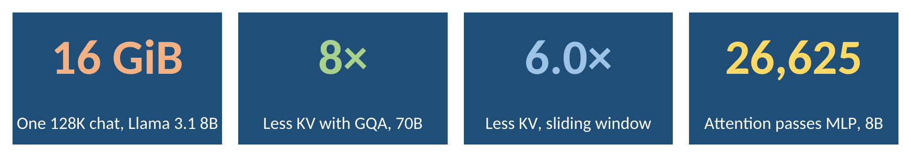

</div>

> Every chart is a **native Excel chart** from [`excel/llm_context_window_math.xlsx`](excel/llm_context_window_math.xlsx). Every number is a live formula on the architecture table, so you can add your own model or change the precision and see the result.

## Contents

- [The short version](#the-short-version)
- [Key results](#key-results)
- [How a model reads a long prompt](#how-a-model-reads-a-long-prompt)
- [The equations](#the-equations)
- [The models](#the-models)
- [Result gallery](#result-gallery)
- [Three tricks that shrink the KV cache](#three-tricks-that-shrink-the-kv-cache)
- [Worked examples](#worked-examples)
- [What this means for you](#what-this-means-for-you)
- [Using the Excel workbook](#using-the-excel-workbook)
- [Run it](#run-it)
- [Project layout](#project-layout)
- [FAQ](#faq)
- [Glossary](#glossary)
- [Limits](#limits)
- [ملخص بالعربي](#ملخص-بالعربي)

## The short version

A language model does two kinds of work for each new token:

1. **Fixed work** in its weights, which costs the same no matter how long the context is.
2. **Attention work,** where the new token looks back at every earlier token. This grows with the context.

To avoid recomputing the past, the model stores two vectors, a **key** and a **value**, for every earlier token in every layer. This store is the **KV cache**. It lives in GPU memory, it grows linearly with the context, and every user needs their own copy. That is the real reason long contexts are expensive to serve.

## Key results

| Model | Parameters | KV per token | KV at 128K tokens | Attention passes MLP at |
|---|---:|---:|---:|---:|
| Llama 3.2 1B | 1.24 B | 32 KiB | 4.0 GiB | 14,850 |
| Llama 3.2 3B | 3.21 B | 112 KiB | 14.0 GiB | 16,386 |
| Llama 3.1 8B | 8.03 B | 128 KiB | 16.0 GiB | 26,626 |
| Llama 3.1 70B | 70.55 B | 320 KiB | 40.0 GiB | 52,226 |
| Llama 3.1 405B | 405.85 B | 504 KiB | 63.0 GiB | 97,282 |
| Gemma 7B | 8.54 B | 448 KiB | 56.0 GiB* | 33,793 |
| Gemma 2 27B | 27.23 B | 368 KiB | 23.7 GiB* | 134,149 |
| Gemma 3 27B | 27.01 B | 496 KiB | **10.4 GiB** | 307,172 |

bf16 values, one sequence. KV per token assumes every layer keeps the full context. \* Gemma 7B and Gemma 2 were trained for 8K tokens, so 128K shows the memory they would need, not something they support.

What this shows:

- **One 128K-token conversation on Llama 3.1 8B needs 16 GiB of KV cache,** more than the 15 GiB of the model's own weights.
- **Grouped-query attention cuts the KV cache 8×** on Llama 3.1 70B, from 320 GiB to 40 GiB at 128K tokens.
- **Gemma 3's sliding window cuts it 6×.** 52 of its 62 layers only look at the last 1,024 tokens, so the 10 global layers hold 96% of the cache.
- **At long contexts, attention dominates the work.** On Llama 3.1 8B, attention becomes larger than all other compute after about 26,600 tokens, and takes 83% of the work for a token at position 128K.
- **Parameter count does not predict KV size.** Gemma 7B needs 448 KiB per token, more than Llama 3.1 70B's 320 KiB, because it uses one KV head per query head.

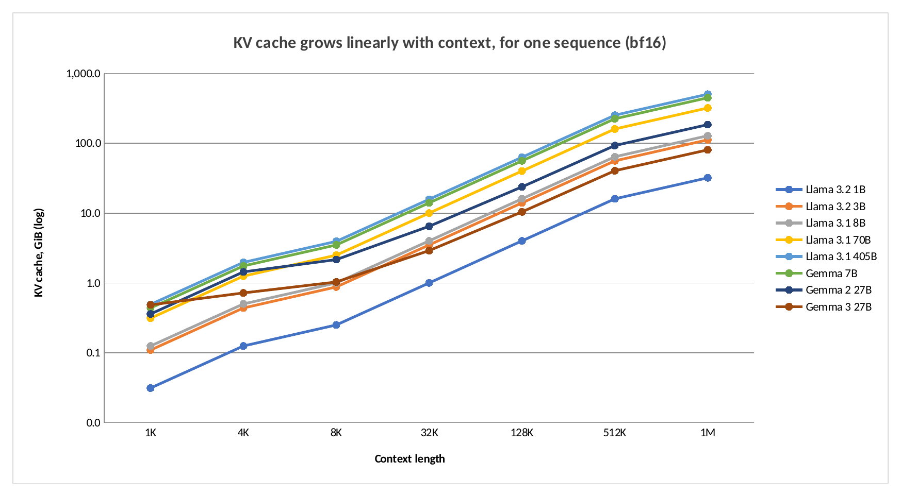

## How a model reads a long prompt

<p align="center">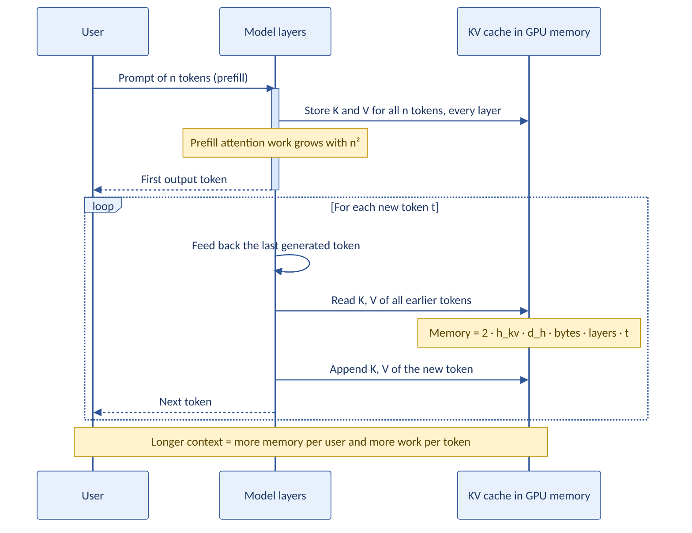</p>

There are two phases:

- **Prefill:** the whole prompt is processed at once. Every token attends to every earlier token, so the attention work grows with the square of the prompt length. The K and V vectors of every token are stored.
- **Decode:** answers come out one token at a time. Each new token reads the full KV cache, does its attention over all earlier tokens, and adds its own K and V.

## The equations

**KV cache memory** for a context of $n$ tokens, with $h_{kv}$ key-value heads of dimension $d_h$, $b$ bytes per value, $L_g$ layers with full attention and $L_\ell$ layers with a sliding window of $W$ tokens:

$$M_{kv}(n) = 2\, h_{kv}\, d_h\, b\, \big(L_g\, n + L_\ell \min(n, W)\big)$$

The factor 2 is for keys and values. Multiply by the batch size for several users.

**Weights memory** for $N$ parameters at $b_w$ bytes each:

$$M_w = N\, b_w$$

**Parameters** of a Llama- or Gemma-style model with width $d$, $h$ query heads, FFN width $f$, vocabulary $V$ and $L$ layers:

$$N = V d\,(2 - \text{tied}) + L\big(\underbrace{2 d h d_h + 2 d\, h_{kv} d_h}_{\text{attention}} + \underbrace{3 d f}_{\text{gated MLP}} + c\,d\big) + d$$

This reproduces each model's size: 8.03 B for Llama 3.1 8B and 405.85 B for Llama 3.1 405B.

**Compute for one new token** at position $t$. The weight matrices cost about two operations per parameter, and attention scores and the weighted sum cost $4\,t\,h\,d_h$ per layer:

$$F_{\text{lin}} \approx 2 N_{\text{non-emb}}, \qquad F_{\text{att}}(t) \approx 4\, L\, t\, h\, d_h$$

**Crossover point,** where attention work equals everything else:

$$t^{*} = \frac{N_{\text{non-emb}}}{2\, L\, h\, d_h}$$

For Llama 3.1 8B: $t^* = 6.98 \times 10^9 / (2 \times 32 \times 32 \times 128) \approx 26{,}600$ tokens.

**Longest context that fits** in GPU memory $G$, without a sliding window:

$$n_{\max} = \frac{G - M_w}{2\, h_{kv}\, d_h\, b\, L}$$

## The models

Architectures come straight from the official configuration files: Llama from [`meta-llama/llama-models`](https://github.com/meta-llama/llama-models) (`models/sku_list.py`) and Gemma from [`google/gemma_pytorch`](https://github.com/google/gemma_pytorch) (`gemma/config.py`).

| Model | Layers | Width | Query heads | KV heads | Head dim | Sliding window |
|---|---:|---:|---:|---:|---:|---|
| Llama 3.2 1B | 16 | 2,048 | 32 | 8 | 64 | none |
| Llama 3.2 3B | 28 | 3,072 | 24 | 8 | 128 | none |
| Llama 3.1 8B | 32 | 4,096 | 32 | 8 | 128 | none |
| Llama 3.1 70B | 80 | 8,192 | 64 | 8 | 128 | none |
| Llama 3.1 405B | 126 | 16,384 | 128 | 8 | 128 | none |
| Gemma 7B | 28 | 3,072 | 16 | 16 | 256 | none |
| Gemma 2 27B | 46 | 4,608 | 32 | 16 | 128 | 23 layers, 4,096 tokens |
| Gemma 3 27B | 62 | 5,376 | 32 | 16 | 128 | 52 layers, 1,024 tokens |

## Result gallery

### Memory

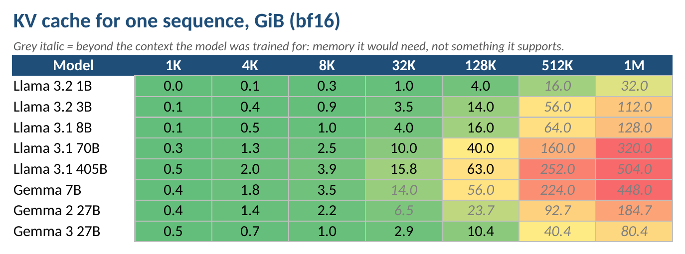

| Llama 3.1 8B on one 80 GB GPU | Longest context in 80 GB |
|---|---|
| 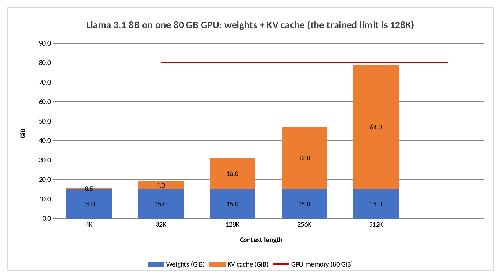 | 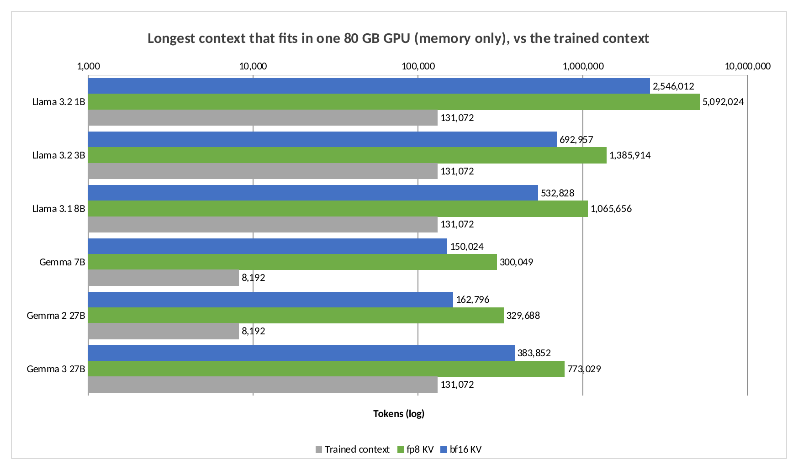 |

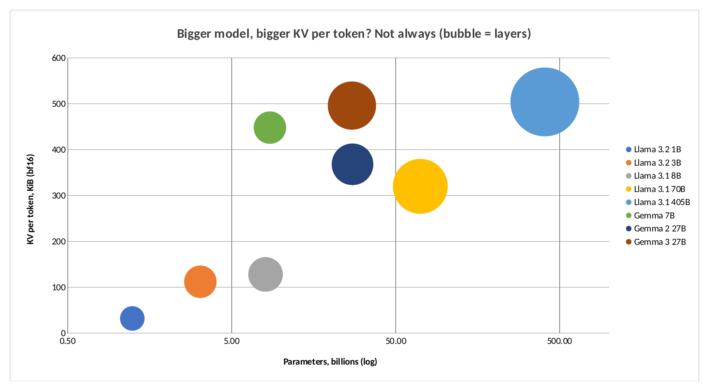

### Compute

| Attention share by model | Llama 3.1 8B, split by position |
|---|---|
| 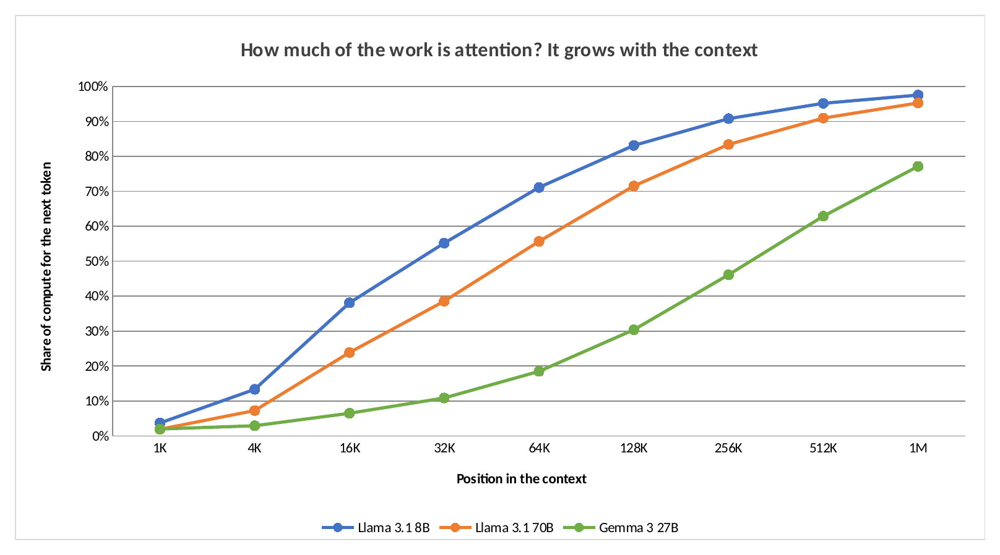 | 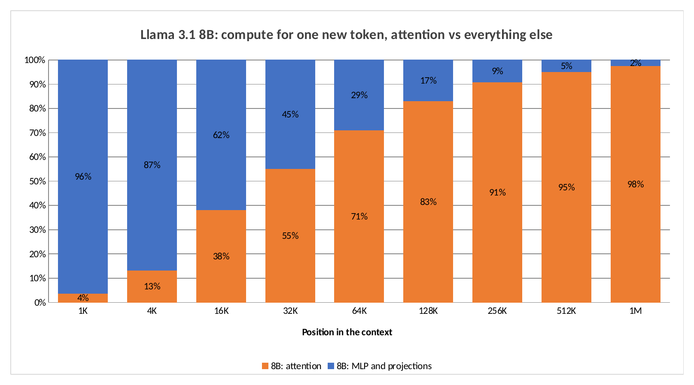 |

### Design choices

| From 124 GiB to 5.2 GiB | Global vs local layers |
|---|---|
| 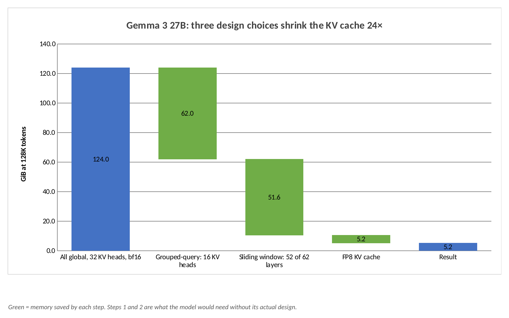 | 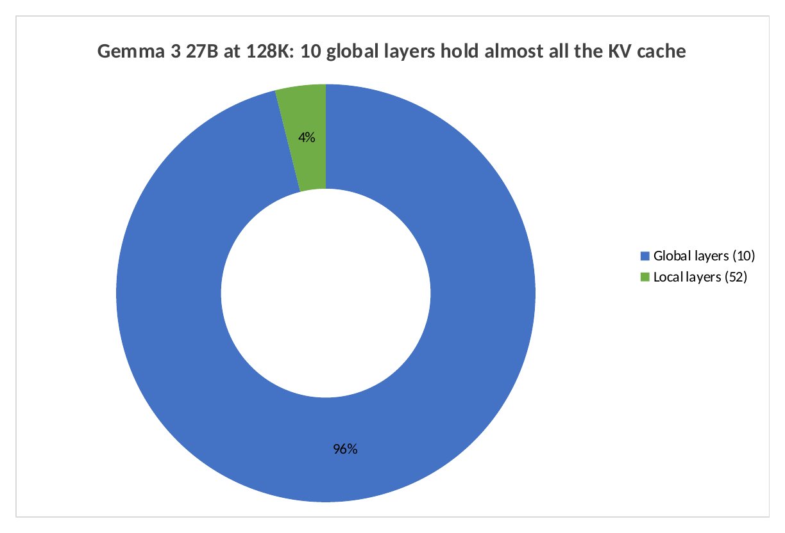 |

| Grouped-query attention on Llama 3.1 70B |
|---|
| 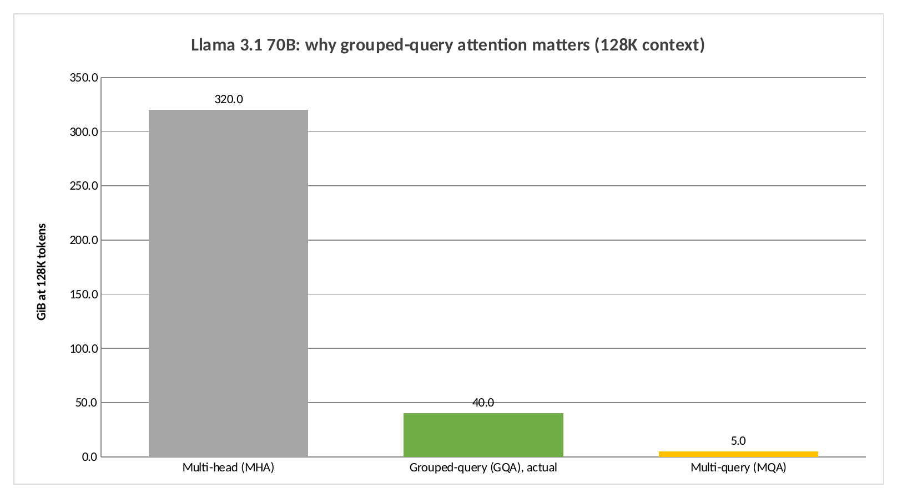 |

## Three tricks that shrink the KV cache

**1. Grouped-query attention (GQA).** Several query heads share one key-value head. Llama 3.1 70B has 64 query heads but only 8 KV heads, so it stores 8× less than classic multi-head attention. Multi-query attention goes further, with a single KV head, at the cost of some quality.

| Llama 3.1 70B at 128K | KV heads | KV cache |
|---|---:|---:|
| Multi-head attention | 64 | 320 GiB |
| Grouped-query, actual design | 8 | **40 GiB** |
| Multi-query attention | 1 | 5 GiB |

**2. Sliding-window attention.** Some layers only look at the last $W$ tokens, so their cache stops growing. Gemma 3 27B uses 5 local layers with a 1,024-token window for every global layer. At 128K tokens its 52 local layers need only 0.4 GiB, while its 10 global layers need 10 GiB.

**3. Lower precision.** Storing K and V in 8 bits instead of 16 halves the cache. Quality effects depend on the model and method.

Together, on Gemma 3 27B at 128K tokens:

| Step | KV cache |
|---|---:|
| All layers global, 32 KV heads, bf16 | 124.0 GiB |
| Grouped-query attention, 16 KV heads | 62.0 GiB |
| Sliding window on 52 of 62 layers | 10.4 GiB |
| FP8 KV cache | **5.2 GiB** |

The first two rows are what the model would need without its real design. The last row is an option for serving, not part of the published model.

## Worked examples

**How many users fit on one GPU?** Llama 3.1 8B in bf16 takes 15 GiB for weights. Counting an 80 GB GPU as 80 GiB, that leaves about 65 GiB. Each 32K-token conversation needs 4 GiB of KV cache, so about **16 conversations** fit at once, before counting any other overhead.

**Why a 1M-token context is hard.** Llama 3.1 8B would need 128 GiB of KV cache for one 1M-token sequence, more than an 80 GB GPU holds even before the weights. The trained limit of Llama 3.1 is 128K tokens.

**Why the first token takes longer with a long prompt.** Prefill attention grows with $n^2$. Doubling a 64K prompt to 128K roughly quadruples the attention work of prefill.

## What this means for you

- **Shorter context is faster and cheaper to serve.** Send only what the task needs, and search first instead of pasting whole archives.
- **Repeated context should be cached.** Many APIs offer prompt caching, so a long fixed prefix is processed once and reused.
- **API prices are per token, not per token squared.** For example, Anthropic's pricing page says Claude 4.6 and later models, except Haiku 5.5, include the full 1M-token context at standard per-token prices. Your bill grows linearly with tokens even though the provider's work grows faster.
- **When you choose an open model to run yourself, check its KV heads and attention design,** not only its parameter count. Gemma 7B needs 3.5× the KV memory of Llama 3.1 8B per token.

## Using the Excel workbook

| Sheet | What it holds |
|---|---|
| Overview | Four headline numbers |
| KV Calculator | Enter layers, KV heads, head dimension, precision, context and batch |
| Models | The architecture table in blue. Parameters, KV per token and crossover are formulas |
| KV Cache | Heatmap of KV cache for every model and context |
| Inputs | Precision, GPU memory and the context used for the headline tiles |
| Chart sheets | 10 native Excel charts |

Try this: in `Inputs`, set bytes per KV value to 1 for FP8, and every chart halves its KV numbers. Or add a row to `Models` with your own architecture.

## Run it

```bash
pip install -r requirements.txt
python run_analysis.py           # every number -> results/analysis.json
python build_excel.py            # workbook with formulas and charts
python render_excel_charts.py    # chart images, needs LibreOffice
pytest tests                     # checks the equations
```

## Project layout

```text
ctxmath/models.py           Architectures from official configs
ctxmath/formulas.py         Parameters, KV cache, compute, crossover, GPU limit
run_analysis.py             All numbers in this README
build_excel.py              Workbook where every number is a formula
render_excel_charts.py      Exports chart images
xlkit/charts.py             Excel chart helpers and renderer
tests/test_formulas.py      Checks parameter counts and key results
excel/llm_context_window_math.xlsx
```

## FAQ

**Why does Gemma 3 27B have a smaller KV cache than Llama 3.1 8B at 128K?**
Its sliding window. Only 10 of its 62 layers keep the whole context. Per token across all layers it would need more, 496 KiB against 128 KiB, but most layers stop growing after 1,024 tokens.

**Does the KV cache grow with the square of the context?**
No, it grows linearly. What grows with the square is the attention work during prefill, because every token attends to every earlier one.

**Why does attention matter less for bigger models?**
The weight work grows with model width squared, while attention work grows with width times context. Bigger models have more fixed work, so attention passes it later: 26,600 tokens for 8B against 97,300 for 405B.

**Are these the exact numbers in production?**
They are the core arithmetic. Real servers add memory for activations, fragmentation and batching, and may use paged or compressed caches. Use these numbers as a lower bound for memory.

## Glossary

| Term | Meaning |
|---|---|
| Context window | The maximum number of tokens the model can attend to at once |
| KV cache | Stored keys and values of earlier tokens, one set per layer |
| Prefill | Processing the whole prompt at once |
| Decode | Generating the answer one token at a time |
| MHA | Multi-head attention: one KV head per query head |
| GQA | Grouped-query attention: query heads share fewer KV heads |
| MQA | Multi-query attention: all query heads share one KV head |
| Sliding window | Attention limited to the most recent $W$ tokens |
| bf16, fp8 | Number formats with 2 and 1 bytes per value |
| GiB | 1024³ bytes. This project counts an 80 GB GPU as 80 GiB, close to what such cards report |

## Limits

- **These are analytical estimates, not measurements on a GPU.** Real systems need extra memory for activations and the serving framework.
- FLOP counts leave out softmax, normalization and position encoding, which are small.
- Gemma 3 27B's attention pattern is taken as 5 local layers then 1 global, repeated over 62 layers, as in its config.
- Values beyond each model's trained context show memory needs only.
- Llama 4 is not included, because its mixture-of-experts layout needs a separate treatment.

## Author

**Jaafar Salim**, University of Technology, Iraq

## ملخص بالعربي

<div dir="rtl">

هذا المشروع يشرح بالمعادلات ليش السياق الطويل بالنماذج اللغوية مكلف، ويحسب كل شي لـ 8 نماذج حقيقية من ملفات إعداداتها الرسمية.

- **ذاكرة KV cache:** النموذج يخزن مفتاح وقيمة لكل توكن سابق بكل طبقة. بـ Llama 3.1 8B، محادثة وحدة طولها 128 ألف توكن تحتاج 16 جيجابايت، يعني أكثر من أوزان النموذج نفسه.
- **الانتباه:** بعد حوالي 26,600 توكن، يصير شغل الانتباه أكبر من باقي الحسابات، وعند 128 ألف يصير 83% من الشغل.
- **الحلول:** الانتباه المجمّع (GQA) يقلل الذاكرة 8 مرات بـ Llama 3.1 70B، والنافذة المنزلقة بـ Gemma 3 تقللها 6 مرات، وصيغة FP8 تنصّفها.
- **عدد المعاملات المحسوب بالمعادلات يطابق حجم كل نموذج،** وهذا يأكد صحة الحسابات.

افتح ملف Excel وغيّر أي رقم أزرق، وكل الرسومات تتحدث.

</div>
